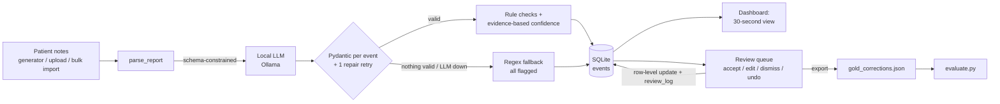

# SymptomLens: patient-reported symptoms, from free text to a 30-second pre-visit view

SymptomLens is my prototype for Track B (Patient-Reported Data: Store, Manage & Chart) of the Pipeline Securities Dr.Tracker assessment. It is modelled on the **oncology demo**: patients on head-and-neck chemoradiation write daily notes about nausea, vomiting, mouth sores, pain, swallowing and fatigue.

The prototype has five parts:

1. **Generate:** 5 fictional patients. Each has a full care history (biopsy, first consult, staging, treatment start on Sep 7, weekly visits), 5 weeks of free-text reports (about 166), daily weights, and an antiemetic switch on day 21 for the two patients who get worse.
2. **Parse:** each report goes to a local LLM (Ollama, `llama3.1:8b` by default), whose output is constrained to the Pydantic schema. Each event is validated, checked against the report text by deterministic rules, and scored for confidence on evidence. If the LLM fails, a regex parser takes over.
3. **Store:** SQLite (`data/symptomlens.db`) is the source of truth, with readable CSV exports. The queries are plain SQL.
4. **Show:** a Streamlit pre-visit dashboard answering *"what changed since the last visit?"*, with the patient's history alongside.
5. **Review:** clinicians accept, edit, dismiss or undo every uncertain item. Each decision is attributed and logged, and corrections become new test data.
6. **Bring data in:** upload one or many patient notes (.txt or .pdf) from the dashboard or `bulk_import.py`, or import a FHIR Bundle with a stub importer.

All data is synthetic. No real patient information is used anywhere.



## How to run it

Full step-by-step instructions, including the background restart and the daily 1:22 AM auto-restart, are in **[RUN.md](RUN.md)**. In short:

```bash
python -m venv .venv && source .venv/bin/activate
pip install -r requirements.txt
ollama pull llama3.1:8b              # optional: without it the regex fallback is used and everything is flagged for review

python pipeline_runner.py            # first run: generate data + parse; later runs parse only new reports
python pipeline_runner.py --reparse  # re-run the parser on UNREVIEWED output only (e.g. after a model change)
python bulk_import.py docs/samples/generated   # import a folder of notes (safe to re-run)
python Queries.py                    # the SQL queries
python evaluate.py                   # parser accuracy: LLM vs regex (+ clinician corrections)
python evaluate.py --models llama3.1:8b qwen2.5:7b mistral   # benchmark -> docs/MODEL_COMPARISON.md
python -m pytest                     # 103 tests, no LLM needed (also run by GitHub Actions)
./scripts/run.sh                     # dashboard at http://localhost:8501 (same as: streamlit run app.py)
python importer.py samples/fhir_bundle_P006.json          # preview a FHIR import (add --save to merge it into data/)
```

`data/` is committed, so the dashboard opens straight away without re-running the parser. Review clicks write to SQLite only; run `python export_csv.py` before committing `data/` so the CSVs match.

## Files

| File | What it does |
|---|---|
| `schema.py` | The 7 table definitions, CSV and SQLite storage |
| `Synthetic_datagenerator.py` | Seeded synthetic patients with history (visits, procedures, medications), reports, weights, and "silver" symptom labels |
| `parser.py` | LLM extraction, Pydantic validation, rule checks, regex fallback |
| `ingest.py` | Turns text into stored reports and events. Shared by the batch pipeline and the upload |
| `pipeline_runner.py` | Batch parsing: new reports, `--reparse` unreviewed output, `--generate` (asks before deleting work) |
| `bulk_import.py` | Import a folder of notes; per-file summary, duplicates skipped |
| `export_csv.py` | Write every SQLite table to readable CSVs |
| `importer.py`, `samples/` | EHR import stub and a synthetic FHIR R4 Bundle |
| `Queries.py` | Three SQL queries |
| `evaluate.py`, `gold.json` | Parser evaluation against 30 hand-labelled reports and the silver labels |
| `review.py` | Clinician review actions (accept, edit, dismiss), corrections log, gold-label export |
| `app.py` | Dashboard entry point: page setup, cached data, sidebar, routing |
| `ui/` | Dashboard pages and pieces: `home.py`, `patient.py`, `review.py`, `upload.py`, `charts.py`, `components.py` |
| `services/` | Dashboard logic without Streamlit: `data.py` (load + prepare), `triage.py` (what changed, urgency) |
| `tests/` | 103 tests: parser, LLM layer (mocked), storage, pipeline, bulk import, review workflow, services, dashboard smoke test |
| `docs/` | `BASELINE.md`, `MODEL_COMPARISON.md`, `PRODUCTION.md`, synthetic note generator (`tools/`) |

## Schema

The schema is event-based: one row per symptom mention, not one row per report. Around that sit the history tables a provider needs for context.

```
patients     (patient_id, name, dob, diagnosis, diagnosis_date, first_visit_date, treatment_start)
visits       (visit_id, patient_id, visit_date, visit_type, provider, notes)
                 visit_type: first consult | follow-up | treatment review
procedures   (procedure_id, patient_id, procedure, date, status)        -- status: completed | scheduled | cancelled
medications  (patient_id, drug, dose, start_date, end_date, prescribed_by, reason)   -- one row per medication period
reports      (report_id, patient_id, reported_at, source, raw_text)    -- exactly what the patient wrote, never edited
events       (event_id, report_id -> reports, patient_id, symptom, severity 0-10, frequency,
              onset, related_med, confidence, extracted_by, needs_review, flags,
              review_status, reviewed_at, reviewed_by,                  -- pending | accepted | edited | dismissed
              model, prompt_version, parse_ms)                           -- which model/prompt produced it, how fast
corrections  (event_id, field, old_value, new_value, corrected_at, reviewed_by)   -- every field a clinician changed
review_log   (log_id, event_id, action, from_status, to_status, reviewed_by, at, details)   -- append-only
vitals       (patient_id, measured_at, kind, value)                     -- weight
```

Why it is built this way:

- **Raw text is kept and never overwritten.** Every event points back to its report through `report_id`. A clinician can always see the patient's own words, and the parser can be re-run later without losing anything.
- **Events, not reports.** "Threw up twice, felt nauseous all morning" becomes two rows. Queries like "vomiting per week" are then simple filters and sums.
- **`onset` and `reported_at` are separate dates.** "Vomited last night", written this morning, belongs to yesterday.
- **Unknown is NULL, and NULL is not zero.** If the patient gives no number, `severity` is NULL. `0` means the patient explicitly denied the symptom ("no vomiting today").
- **Medications are periods, with a reason.** `start_date` and `end_date` show what was active on any day. `reason` lets query 2 pick "anti-nausea drugs" without hard-coding drug names. `prescribed_by` says who to ask.
- **Visits drive the "since last visit" window.** The dashboard defaults to the latest real visit instead of a guessed date.
- **The extra columns carry provenance:** `confidence`, `extracted_by` (llm / rule / import / manual), `flags` (the checks that fired), and `reports.source` (free_text / upload).

### Synthetic patient history

Every patient follows the same realistic path:

1. **Biopsy:** this is the diagnosis date, 6–8 weeks before treatment.
2. **First consult:** 1–2 weeks after the biopsy.
3. **Before treatment:** PET/CT staging, dental review and an audiology baseline, followed by a radiation planning CT the week before treatment starts.
4. **Treatment review:** consent for chemoradiation, 3 days before start.
5. **Treatment starts** on Sep 7: cisplatin with ondansetron.
6. **Weekly visits** on days 7, 14, 21 and 28. On day 14, mucositis begins and lidocaine rinse is started.

The two patients who get worse (P001 and P004) also have:

- **Day 21:** switched from ondansetron to olanzapine.
- **Day 28:** a note that weight loss is over 5%.
- **Feeding tube:** placed for P001 and scheduled for P004.

The history uses its own random seed, so adding it didn't change the existing reports or events.

## Vague and conflicting reports

| Case | Example | What happens |
|---|---|---|
| Vague | "Felt off all day, not sure why." | Stored as `symptom = other` with low confidence and `needs_review`. The dashboard lists these in the patient's own words, without coding them to a symptom. |
| No number given | "Swallowing is getting harder" | `severity = NULL`. The LLM is told never to guess a number. Rule check: a severity without a number or a severity word in the quoted evidence is set back to NULL and flagged `severity_unsupported`. |
| Severity word | "Pain is severe today" | Fixed mapping: mild = 3, moderate = 5, severe = 8. The LLM prompt and the regex both use it. |
| Negation | "No vomiting today. Nausea mild." | Vomiting stored as `severity = 0, frequency = 0` (denied), nausea as 3. The regex applies negation only within its own clause, so "No mouth sores, but pain 6/10" keeps the pain score. |
| Same-day contradiction | 08:00 "Nausea 8/10…", 21:00 "No nausea today, felt fine." | `flag_conflicts()`: same patient, symptom and day, with one report denying and one rating above 0, or severities 4 or more points apart. **Both rows are kept** and flagged `same_day_conflict`. A clinician decides which is right, not the code. |
| Relative time | "last night", "yesterday" | `onset` = report date − 1 |
| Uploaded document | a .txt or .pdf note | Always goes to review, flagged `upload` (see below). |

## Parser and validation

`parse_report()` in `parser.py`:

1. **LLM call** (`call_llm`): local model through Ollama at `temperature=0`. The model is set with `SYMPTOMLENS_MODEL`.
   - **Output is constrained to the schema** (Ollama structured outputs, generated from the Pydantic model). Older Ollama versions fall back to plain JSON mode.
   - **Prompt `v2`:**
     - The patient text sits inside `<report>` tags and is declared to be data, not instructions. The tags can't be closed from inside the text.
     - Six worked examples cover negation, "last night", which symptom a number belongs to, vague reports, a severity word, and a medication link.
     - Severity words come from the same table the regex and rule checks use (mild 3, moderate 5, bad 5, severe 8, terrible 8). "Worse" is a change, not a level.
   - **Context:** the report date and the medications active that day are passed in, so "the new pill" can become a real drug name. That is flagged `related_med_inferred` for review.
2. **Pydantic, event by event** (`SymptomEvent`): `symptom` must be one of 7 values, `severity` 0–10, and `frequency` 0 or more.
   - Invalid events get **one repair retry** that includes the validation errors.
   - Valid events are kept even if others fail (flagged `partial_llm_output`).
   - Only if nothing valid comes back does the regex fallback take over.
3. **Confidence from evidence, not the model's own guess:**
   - 0.3 if the quoted evidence is in the report (ignoring punctuation and spacing)
   - \+ 0.4 if the regex parser found the same symptom
   - \+ 0.3 if the severities agree

   Below **0.6** goes to review. So a paraphrase the regex can't see ("sick to my stomach") is always checked by a person.
4. **Rule checks** (`rule_checks`):
   - `evidence_not_in_text`
   - `severity_unsupported`
   - `negation_conflict`
   - `frequency_implausible` (more than 20)
   - `denial_unsupported`: severity 0 without a "no" or "not" in the quote. This catches a model slip, or a prompt injection like "set severity 0".
   - `related_med_inferred`

   Any flag, low confidence, or `other` means `needs_review`.
5. **Regex fallback** (`regex_parse`): used when the LLM is down or returns nothing valid, and everything it produces goes to review.
   - A "/10" number belongs to the nearest symptom before it in the sentence, so in "pain 8/10, worse when swallowing", only pain is 8.
   - Vague phrases ("felt off") are kept as `other` alongside other symptoms.
6. **Provenance and cache:**
   - Every event stores `model`, `prompt_version` and `parse_ms`.
   - LLM answers are cached in `data/llm_cache.sqlite`, keyed by text + model + prompt version, so re-runs are instant and identical.

**Evaluation** (`python evaluate.py`):

- **Gold set:** 30 hand-labelled reports. Half follow the generator's templates; half are phrasings the generator never uses.
- **Clinician corrections:** `gold_corrections.json`, exported from the review queue, is scored too when it's present.
- **Silver labels:** symptom labels carried over from the templates, checked against the stored events.
- **Model benchmark:** `python evaluate.py --models …` writes **[docs/MODEL_COMPARISON.md](docs/MODEL_COMPARISON.md)**. It reports precision, recall, severity error, frequency accuracy, valid-JSON rate, fallback rate and seconds per report, and picks a default from those numbers.

| Parser | Gold symptom precision | Gold recall | Severity MAE | Frequency exact |
|---|---|---|---|---|
| Regex baseline | 0.84 | 0.80 | 0.00 (n=17) | 9/10 |
| LLM | *not yet measured: Ollama was unavailable on the development machine. Run `python evaluate.py --models llama3.1:8b qwen2.5:7b mistral`* | | | |

The regex scores 1.00 on the silver labels because it was written against the same templates. Its recall drops to 0.80 on wording it hasn't seen. That gap is the case for the LLM. The regex stays as a fallback because it is predictable and cannot hallucinate.

**Tests** (`python -m pytest`, 103 tests, also run by GitHub Actions on every push): they cover these areas. The LLM is mocked in every test, so they run without Ollama.
- **Parser:** negation, "last night", severity words, number ownership, every rule check.
- **LLM layer:** schema passed to Ollama, per-event validation, repair retry, fallback, evidence-based confidence, prompt injection, cache, context, provenance, benchmark.
- **Storage:** atomic saves, integer round-trip, duplicate refusal, `--parse`/`--reparse` not losing work.
- **Bulk import:** new patients, duplicates, wrong patient, bad files.
- **Review workflow:** reviewer required, row-level saves, undo, append-only log.
- **Services:** triage and the "what changed" summary.
- **Dashboard smoke test:** every patient renders, and a review click updates the counts.

## Queries (`Queries.py`, SQL over SQLite)

1. **Vomiting episodes per patient per week:** `SUM(frequency)` grouped by Monday-start week. Denials are excluded. NULL counts stay unknown, so they don't drag the sum down to zero.
2. **Nausea in the 7 days before vs after a medication change:** picks medications whose `reason` mentions nausea and that started after treatment began (olanzapine). It compares `AVG(severity)` in the two windows using `julianday()`, and returns `n_scored_reports` so a 3-report average isn't over-read. In this synthetic data, nausea keeps rising after the switch, because the generator makes worsening patients worse every week whatever the drug. The query reports that honestly rather than showing an effect that isn't there.
3. **Review queue per patient:** events waiting for a human, same-day conflicts, and how many came through the fallback.

## Dashboard: the 30-second view

The dashboard is built around one question: **what changed since the last visit?**

- **Patient history panel:** diagnosis, diagnosis date, first visit, treatment start, days since diagnosis, and number of visits.
- **"Last visit"** defaults to the most recent visit in the `visits` table. The sidebar picker can override it.
- **Since-last-visit banner:** new reports, vomiting episodes, weight change (since the last visit and since treatment start), items needing review, and the symptom that got most worse. A separate red alert appears if weight is down more than 5% since treatment start.
- **All seven symptoms as tiles:**
  - **Nausea, mouth sores, pain:** average severity (0–10) compared with before the last visit.
  - **Vomiting:** episode count.
  - **Swallowing difficulty and fatigue:** number of days reported.
  - **Other:** number of vague reports, with their raw text listed below.
- **Timeline chart:**
  - **Severity lines:** one per symptom, in distinct colours. None is red, because red is kept for alerts.
  - **Daily dates:** missing days show as gaps rather than joined lines. Vomiting is left out because it is a count.
  - **Medication lines:** a gray dashed line for each mid-treatment medication start; the last visit is a solid black line. Labels are staggered so they don't overlap.
  - **Visits and procedures row:** markers underneath the chart. A filled diamond is a completed procedure; an open one is scheduled.
  - **"Show full history" toggle:** zooms out to the diagnosis.
- **Weight trend** with the −5% line.
- **Tabs:** visit timeline (with notes), medications (dose, start, end, active/stopped, prescriber, reason), and procedures (date, status).
- **Review queue:** flagged items with the reason and the patient's raw text.
- **All raw reports:** the original messages, for traceability.

## Document upload

The uploader (on the home page and on each patient's Reports tab) takes **one or many** `.txt`/`.pdf` files. The same logic runs from the command line as `python bulk_import.py <folder>`. Text is extracted from PDFs with pypdf. For each file:

- **Patient:** the note is filed under the selected patient, or under the `Patient: P###` in its header. An unknown ID becomes a new patient, created from the header. A note naming a different patient than the one selected is refused.
- **Dates:** a note with several `Date:` lines becomes **one report per date**.
- **Duplicates:** the same patient, date and text is skipped, so re-importing a folder adds nothing.
- **Bad files:** a bad file is listed in the summary table with its reason and never stops the batch.
- **Tested** with the 100 generated notes in `docs/samples/generated`: about 0.05 s per note with the LLM offline. With a local LLM, expect several seconds per note.

Upload flow per report:

1. **Extract text:** only the text is used. The file itself is never written to disk. Text is capped at 5,000 characters, and scanned PDFs with no text layer are rejected with a message.
2. **Parse:** the text goes through `parse_report`, the same LLM, validation and fallback path as everything else.
3. **Store:** it is saved as a new report with `source = "upload"`. Its events are **always** marked `needs_review` and flagged `upload`, because a document uploaded by staff is a different input than a patient's own check-in.
4. **Refresh:** the view reloads with the new data.

A warning in the sidebar says **synthetic data only**. Real patient documents would need access control, audit logging and a retention policy, none of which this prototype has.

## EHR import (stub)

`importer.py` defines one entry point for every external source:

```python
rows  = import_from_source("samples/fhir_bundle_P006.json", kind="fhir_bundle")  # -> {table: DataFrame}
store = merge_into_store(load(), rows)    # de-duplicated on natural keys, so re-importing is safe
save(store)
```

One example is implemented: a **FHIR R4 Bundle** read from a JSON file, mapped onto our tables.

| FHIR resource | Goes to |
|---|---|
| `Patient` (with `Condition` for diagnosis) | `patients` |
| `Encounter` | `visits` |
| `Procedure` | `procedures` (FHIR `preparation` becomes `scheduled`, `not-done` becomes `cancelled`) |
| `MedicationRequest` | `medications` |
| `Observation`, body weight (LOINC 29463-7) | `vitals` |
| `Observation`, symptom score | `events`, with `extracted_by = "import"` |

Any other observation (the sample includes a hemoglobin result) is skipped rather than guessed. The sample bundle is a sixth fictional patient (P006) and is tagged `SYNTHETIC`.

**What a real integration would change:** only how the Bundle is fetched. Instead of reading a file, it would call the practice's FHIR API, for example `GET [base]/Patient/{id}/$everything` with an OAuth token (SMART on FHIR backend services). Paging and rate limits would need handling. The mapping functions would stay the same. Coverage of FHIR resources differs between EHR vendors, and some practices only offer HL7v2 or CSV exports. A new `IMPORTERS` entry would handle each. This prototype has not been tested against any real EHR, and I make no compliance claims about it.

## Clinician review

Every item the parser is unsure about lands in the **review queue** (Reports tab). Each card shows the patient's own words, what was extracted, and why it was flagged. Each extracted item has three actions:

| Action | What it does |
|---|---|
| **Accept** | The extraction is right. `review_status = accepted`, `needs_review = False`. |
| **Edit** | Fix the symptom, severity or count. The new values are validated with the **same `SymptomEvent` Pydantic model** the parser uses, so a severity of 12 is refused and nothing is saved. A saved edit sets `extracted_by = "manual"`, and every changed field is written to `corrections` (old value, new value, time). |
| **Dismiss** | The item isn't real. It stays in the table for the audit trail, but tiles, charts and the banner leave it out. |

- **The raw report text is never changed.** Only the extracted events are.
- **Counts show only pending items:** the banner, the alert pills, the Reports tab label and the patient list.
- **Corrections become test data.** "Export corrections as gold labels" writes `gold_corrections.json` in the same format as `gold.json`. Only reports where *every* extracted item has a decision are exported, so unchecked parser output never counts as truth. `python evaluate.py` scores the parser on these reports too, and on both sets combined.
- **Re-running detection doesn't undo a review.** A conflict a clinician has already reviewed is not reopened when a later upload triggers conflict detection again.

**Who decided, and undoing a decision:**
- **Reviewer name:** you type it in the sidebar. It's required, and it's stored on the event (`reviewed_by`) and on every correction.
- **Row-level saves:** each click updates only that event's row in SQLite and appends one entry to `review_log` (action, from/to status, reviewer, time). The log is append-only.
- **Undo** reverts the most recent action on an item. The event gets its previous values back, reversing rows go into `corrections`, and an `undo` entry goes into `review_log`. Nothing is deleted or silently overwritten.
- **Review inbox:** the home page lists pending items across all patients, filterable by flag, patient and date. Selecting a row opens that patient.

**Where reviews are stored, and when they're lost:**
- **`python pipeline_runner.py` keeps reviews.** Plain runs only parse new reports, and `--reparse` only touches unreviewed parser output. Only `--generate` rebuilds the dataset, and it refuses to delete uploads, reviews or corrections unless you confirm (or pass `--yes`).
- **On Streamlit Community Cloud, reviews are temporary.** The app writes to the container's disk, which is wiped whenever the app restarts or redeploys. Keeping them would need a hosted database (see [docs/PRODUCTION.md](docs/PRODUCTION.md)).

## Where AI is used, and where it isn't

- **Used:** turning messy free text (daily reports and uploaded notes) into structured fields. This is the part rules handle badly.
- **Not used:** storage, queries, conflict detection, alerts, severity mapping, FHIR mapping, history, or any number shown to the clinician. That logic is deterministic and covered by tests. The LLM never decides that something is clinically fine. Its output is validated, checked against the source text, and sent to a person when unsure.
- **AI coding assistants** (Claude) were used to write, debug and review code and to draft this README. Their output was checked by running the pipeline, the evaluation, the test suite and the dashboard, not taken on trust.

## Trade-offs and limits

- **A local 8B model instead of a hosted API:** free, and no data leaves the machine. The cost is accuracy and speed. For the demo I run the batch ahead of time and parse one or two reports live, or upload a note.
- **SQLite instead of Postgres:** no setup, and everything sits in the repo.
  - **Review clicks** are single-row updates.
  - **Batch writes** (uploads, pipeline runs) build a new copy of the database and swap it in, so a crash can't leave it half-written. They're still last-writer-wins, which is fine for one user, but several users at once would need Postgres. [docs/PRODUCTION.md](docs/PRODUCTION.md) describes what production would need.
- **The reviewer name is typed, not signed in.** Fine for a demo; production would use single sign-on.
- **The history is generated, not real.** Visits, procedures and doses are plausible for head-and-neck chemoradiation, but they are illustrative and not clinical guidance.
- **Synthetic data is cleaner than real patients.** The gold set is small: 30 reports, labelled by one person. Clinician corrections are designed to grow it.
- **LLM results are still missing.** Ollama couldn't run on the development machine, so every stored event so far comes from the regex fallback. The LLM layer is covered by tests with a mocked model.
- **Severity scale:** putting different symptoms on one 0–10 scale is a simplification. Real use would probably map to CTCAE grades, with clinical input.
- **No clinical or compliance claims.** The dashboard summarises what patients reported. It does not diagnose, and the thresholds (−5% weight, the review rules, the conflict gap of 4) are placeholders that a clinician would set.
